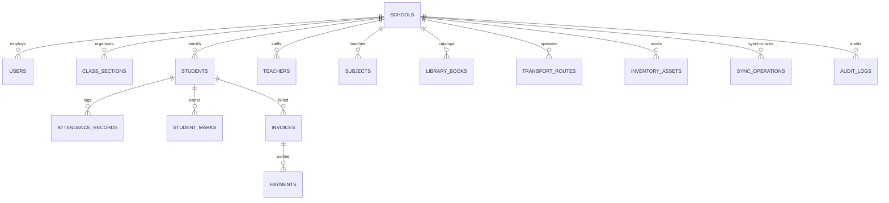

# Ethiopian School Management System (ESMS) — Complete Architecture & Operations Deliverables

## 1. Software Requirements Specification (SRS) & Multi-Tenant Architecture
- **Tenancy Model**: Shared PostgreSQL database with row-level `school_id` ownership enforced by server-side middleware (`verifyTenantAccess`). Cross-tenant queries are rejected with HTTP `403 Forbidden` and logged in `audit_logs`.
- **Hybrid Cloud + Local School Server Topology**:
  - **Cloud Mode**: Central PostgreSQL database + REST API (`/api/v1/*`) acts as the canonical source of truth.
  - **Local School Node & Android Offline Mode**: Approved classroom workflows (Attendance, Continuous Assessment Drafts, Student Admission Queue) buffer operations locally with deterministic UUID `operation_id`, `version_number`, and `client_timestamp`, synchronizing via `/api/v1/sync`.
  - **Financial & Exam Finalization Invariants**: Payment ledger entries (`payments`) require unique `idempotency_key` values and cannot be deleted; adjustments require an explicit `REVERSAL` entry (`reversePaymentTransaction`) with a mandatory audit reason.

## 2. Entity Relationship Diagram (Mermaid)

## 3. Prisma Schema (`schema.prisma` Reference)
See `src/data/deliverablesReference.ts` for the complete Prisma ORM schema, Flutter Android SQLite offline sync client (`lib/services/offline_sync_service.dart`), Docker Compose + Nginx TLS configuration, and Backup/Restore verification procedures.
